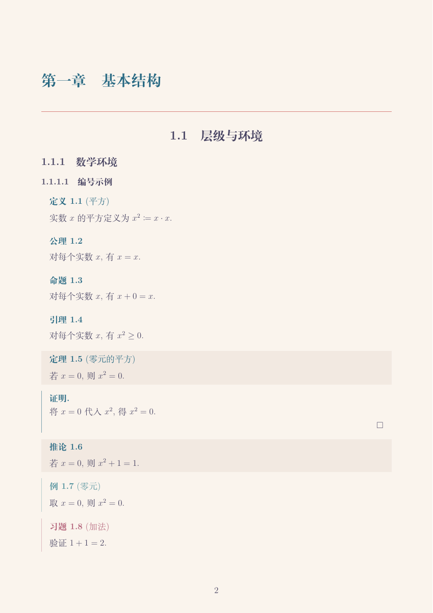
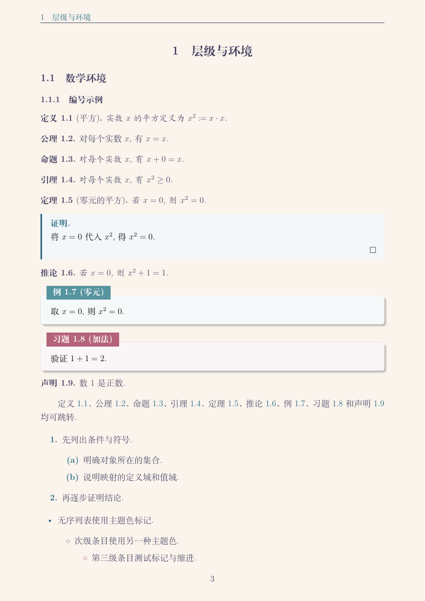
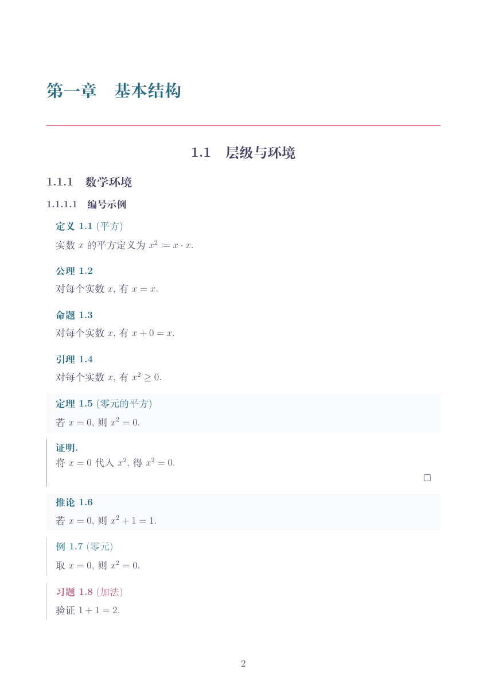
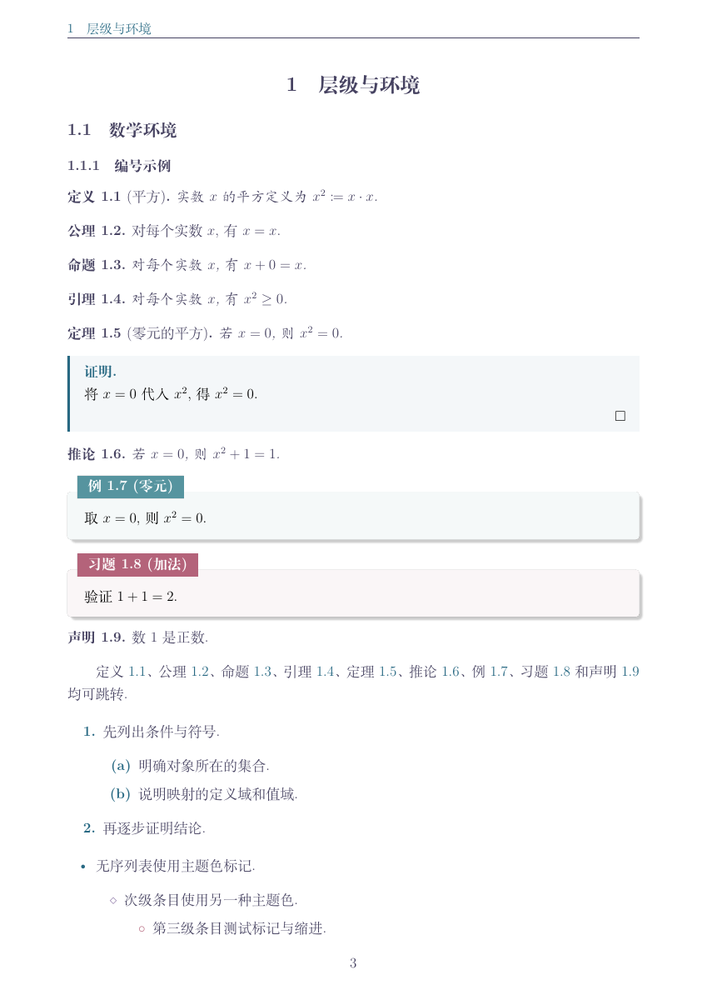
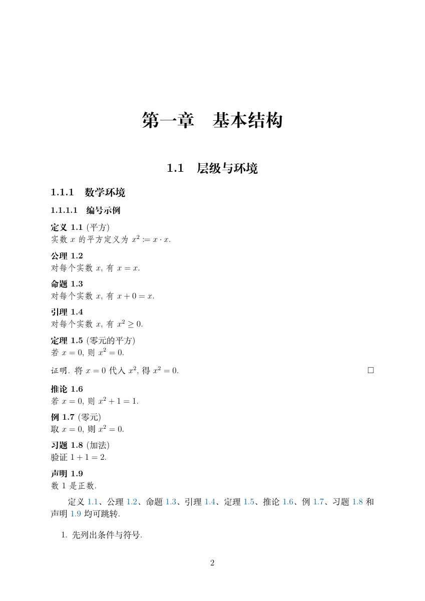
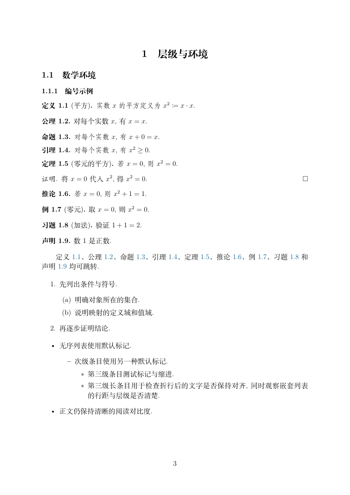

# 输出格式与模板选择

每次任务开始时选择输出格式，再选择相应模板；翻译模组不预设输出格式。EPUB 适合调整字号和连续阅读，LaTeX 适合数学内容、可编辑源码与固定版面 PDF。本项目的 PDF 出版路线会重新排版，模板不会自动还原原书每一页。

## EPUB

内置[通用 EPUB 样式 book.css](../template/epub/book.css)，并提供[参考书示例 reference.epub](../template/epub/reference-book/reference.epub)及其[说明](../template/epub/reference-book/README.md)。微信读书等阅读器可参考[兼容版 compatible.epub](../template/epub/weread-compat/compatible.epub)及[说明](../template/epub/weread-compat/README.md)。

## LaTeX：六种示例

玫瑰松（rosepine）版的配色来自 [Rosé Pine](https://rosepinetheme.com/) 方案，Dawn 使用暖色纸底；白底版保留该配色的强调色。上游主题及许可证保留在[玫瑰松参考目录](../template/tex/reference/rosepine/NOTICE)。数译常规版的来源与许可见[数译参考说明](../template/tex/reference/mathtranslations/NOTICE.md)。

| 模板 | 文档类别 | 可编辑入口 | 编译示例 |
| --- | --- | --- | --- |
| 玫瑰松-dawn | book | [main.tex](../template/tex/rosepine/book/main.tex) | [main.pdf](../template/tex/rosepine/book/main.pdf) |
| 玫瑰松-dawn | article | [main.tex](../template/tex/rosepine/article/main.tex) | [main.pdf](../template/tex/rosepine/article/main.pdf) |
| 玫瑰松白底 | book | [white.tex](../template/tex/rosepine/book/white.tex) | [white.pdf](../template/tex/rosepine/book/white.pdf) |
| 玫瑰松白底 | article | [white.tex](../template/tex/rosepine/article/white.tex) | [white.pdf](../template/tex/rosepine/article/white.pdf) |
| 数译常规版 | book | [main.tex](../template/tex/mathtranslations/book/main.tex) | [main.pdf](../template/tex/mathtranslations/book/main.pdf) |
| 数译常规版 | article | [main.tex](../template/tex/mathtranslations/article/main.tex) | [main.pdf](../template/tex/mathtranslations/article/main.pdf) |

下面是实际 example 文件的正文截图；点击上表 PDF 可查看完整内容。book 包含章级结构，article 使用节级结构。

| | book | article |
| --- | --- | --- |
| 玫瑰松-dawn |  |  |
| 玫瑰松白底 |  |  |
| 数译常规版 |  |  |

使用时复制整个示例目录；白底入口会引用同目录的 `main.tex`，不能只复制 `white.tex`。本地需 XeLaTeX、所需宏包与 Fandol 等字体，再编译两次以上以生成目录及引用。后端约定见[LaTeX 后端设计](LaTeX后端设计.md)。

这些是可手工修改的独立示例。现有自动导出器仍使用 `templates/book` 下的模板，表中六种示例不会因用户口头选名就自动切换为导出器主题；Agent 需要复制所选示例并适配已审核结构。自动导出的工具条件与命令见[模板目录说明](../template/README.md)。

## Typst 模板

<!-- 预留，暂不填写模板。自动 Typst 导出器的现有能力仍见书籍模板说明。 -->

## 追求原版排版风格

希望尽量保留原页排版风格时，推荐另行评估 [PaddleOCR 方案](https://github.com/PaddlePaddle/PaddleOCR)和 [BabeldocPDF（BabelDOC）方案](https://github.com/funstory-ai/BabelDOC)。PaddleOCR 提供版面识别等基础能力，仍需要搭配翻译和排版重建；BabelDOC 提供 PDF 翻译路线。两者都要按原文版面实际试验，不保证逐页完全还原。这里是外部方案索引，本项目当前没有相应的一键后端。
